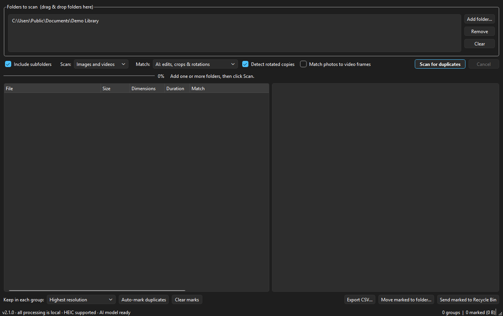
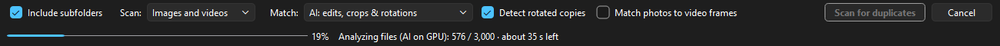
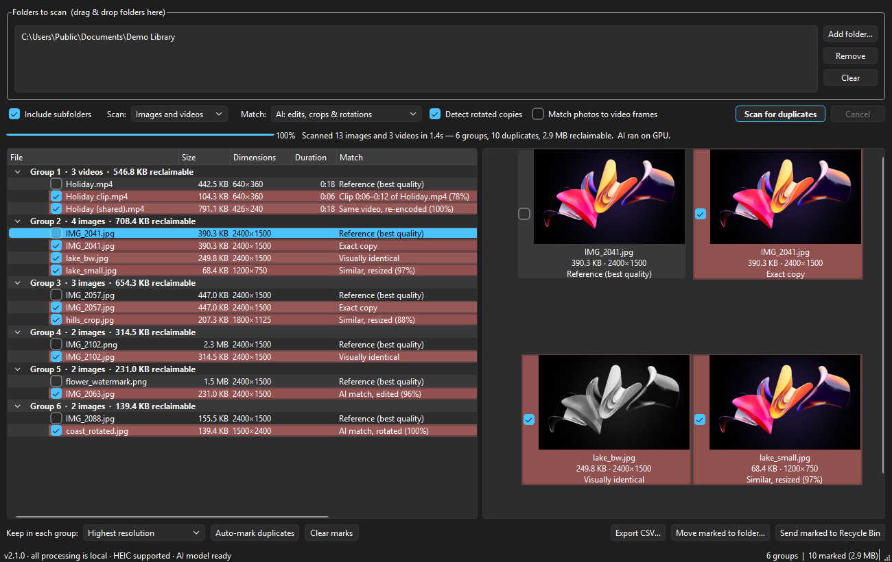
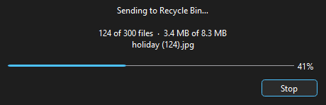
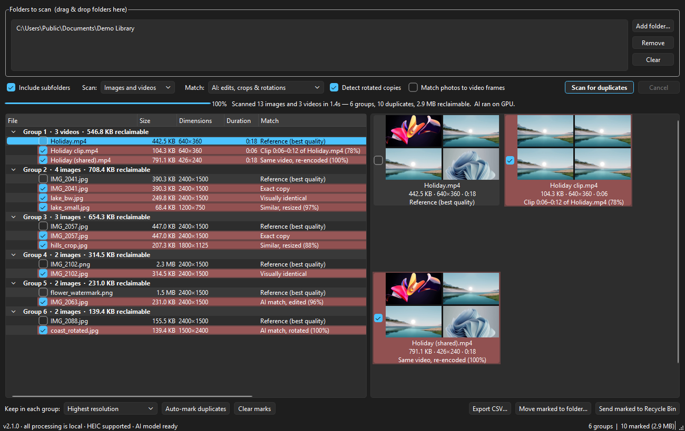

# Media Deduper — User Guide

Media Deduper (the window is titled *Image & Video Duplicate Finder*) finds duplicate photos and
videos on your PC so you can free up space. It finds exact copies, resized or re-saved versions, and,
with its built-in AI model, edited, cropped, rotated and re-encoded versions and trimmed video clips.

Everything runs on your own computer. No files, thumbnails or results are ever uploaded.

**Contents**

1. [Install and run](#1-install-and-run)
2. [The main window](#2-the-main-window)
3. [Scanning for duplicates](#3-scanning-for-duplicates)
4. [Reading the results](#4-reading-the-results)
5. [Choosing what to remove](#5-choosing-what-to-remove)
6. [Removing duplicates](#6-removing-duplicates)
7. [Videos](#7-videos)
8. [Command-line scans](#8-command-line-scans)
9. [Tips and troubleshooting](#9-tips-and-troubleshooting)

---

## 1. Install and run

You need **Windows 10 or 11 (64-bit)**. A graphics card speeds up the AI modes but isn't required.

### Option A: Download the app (recommended)

1. Go to the [latest release](https://github.com/shadytech/media-deduper/releases/latest).
2. Under **Assets**, download **MediaDeduper-*version*-win64.zip** (about 190 MB).
3. Right-click the zip and choose **Extract All…**. Put it anywhere you like, for example
   `C:\Apps\MediaDeduper`.
4. Open the extracted `ImageDupeFinder` folder and double-click **ImageDupeFinder.exe**.

The first time, Windows may show **"Windows protected your PC"**. This appears because the app isn't
code-signed, not because anything is wrong. Click **More info**, then **Run anyway**.

Nothing is installed into Windows. To remove the app, delete its folder. To upgrade, delete the old
folder and extract the new zip; your settings and scan cache are kept.

> Keep the whole `ImageDupeFinder` folder together. The `.exe` needs the `_internal` folder next to it.
> To make a shortcut, right-click the `.exe` and choose **Show more options → Send to → Desktop (create shortcut)**.

### Option B: Run from the source code

Use this if you want to change the code or run the latest unreleased version.

1. Install [Python 3.11 or newer](https://www.python.org/downloads/). On the first installer screen,
   tick **Add python.exe to PATH**.
2. Download this repository: on GitHub click **Code → Download ZIP** and extract it, or run
   `git clone https://github.com/shadytech/media-deduper.git`.
3. Download the AI model (about 84 MB, only needed once). Open PowerShell in the project folder and run:

   ```
   powershell -ExecutionPolicy Bypass -File get_model.ps1
   ```

   Without the model the app still works, but the two **AI** match levels are greyed out.
4. Double-click **run.bat**. The first run takes a few minutes while it creates a Python environment
   (`.venv`) and installs the requirements. Later runs open straight away.
5. The first run also creates a **Media Deduper** shortcut, with the app's icon, in the same folder.
   Use that from then on. To also put it on your Desktop or in the Start menu, run:

   ```
   powershell -ExecutionPolicy Bypass -File make_shortcut.ps1 -Desktop -StartMenu
   ```

   (A `.bat` file can't show its own icon in Windows, which is why the shortcut exists.)

To build your own standalone `.exe` like the one in the releases, run
`powershell -ExecutionPolicy Bypass -File build.ps1`. The result is in `dist\ImageDupeFinder\`.

---

## 2. The main window



From top to bottom:

| Area | What it's for |
|---|---|
| **Folders to scan** | The folders to search. **Add folder…**, **Remove** and **Clear** manage the list. You can also drag folders in from File Explorer. |
| **Options row** | What to scan, how closely files must match, and the **Scan for duplicates** / **Cancel** buttons. |
| **Progress bar and status** | Progress, the current step and the estimated time left during a scan; a summary afterwards. |
| **Results (left)** | Duplicate groups, one row per file. |
| **Preview (right)** | Thumbnails of the selected group. |
| **Action row** | Marking files, exporting a report, and moving or deleting the marked files. |
| **Status bar** | The version, whether HEIC photos and the AI model are available, and how many files are marked. |

The app remembers your folders, options and window size between sessions.

---

## 3. Scanning for duplicates

### Step 1: Add folders

Click **Add folder…** or drag one or more folders onto the window. You can add several folders,
even on different drives; duplicates are found across all of them. To find copies spread around
your PC, add each place you keep photos and videos, for example `Pictures`, `Downloads` and a backup drive.

**Include subfolders** (on by default) also searches every folder inside the ones you added.

### Step 2: Choose what to scan

| Scan | Searches |
|---|---|
| **Images and videos** | Both (default) |
| **Images only** | JPEG, PNG, HEIC/HEIF, WebP, GIF, BMP, TIFF, ICO |
| **Videos only** | MP4, MOV, MKV, AVI, WMV, WebM, M4V, MTS/M2TS/TS, 3GP, MPG, FLV, VOB, OGV |

### Step 3: Choose a match level

The **Match** level sets how alike two files must be to count as duplicates. Stricter levels find
fewer, safer matches; looser levels find more, but need more checking.

| Match level | Finds | Good for |
|---|---|---|
| **Exact copies only** | Byte-for-byte identical files | The safest cleanup; fastest scan |
| **Strict (near-identical)** | The same picture saved again with tiny differences | Cautious cleanup |
| **Normal (resized / re-saved)** | Resized, re-compressed or converted copies (e.g. PNG vs JPG), and re-encoded videos | Everyday use (default) |
| **Loose (light edits)** | Also lightly edited copies | Finding more, with review |
| **AI: edits, crops & rotations** | Also crops, rotations, mirrored, black-and-white or colour-graded versions, watermarks, and trimmed video clips | The most thorough search |
| **AI loose: similar-looking (review!)** | Also different photos that look very alike, such as burst shots | Thinning out similar shots. **Always review before deleting.** |

Hover over the **Match** box for a reminder of what each level does.

Two extra options apply to the AI levels:

- **Detect rotated copies** (on by default) also finds copies turned 90°, 180° or 270°. It makes
  the AI step about four times slower; turn it off for very large libraries if you don't need it.
- **Match photos to video frames** (off by default) finds photos that are a frame of a video,
  such as stills saved from a clip or the photo half of an iPhone Live Photo. See [Videos](#7-videos).

### Step 4: Scan

Click **Scan for duplicates**. The status line shows the current step, the count of files done,
and the estimated time left:



- The time estimate appears after a few seconds and counts down. Mixed photo-and-video folders
  can make it shift a little as the app reaches longer videos.
- **Cancel** stops the scan. Nothing on disk is changed by scanning.
- The app saves what it learns about each file in a cache. **Scanning the same folders again is
  much faster**, because only new or changed files are analysed again.

When the scan finishes, the status line shows a summary, for example
"Scanned 13 images and 3 videos in 1.4s — 6 groups, 10 duplicates, 2.9 MB reclaimable. AI ran on GPU."

---

## 4. Reading the results



Each **group** is a set of files that are copies of each other. The group header shows how many
files it holds and how much space you would get back by keeping just one.

In every group the **first file is the reference**: the best copy, chosen by highest resolution,
then (for videos) highest bitrate and longest duration, then largest file. The **Match** column
says how every other file relates to it:

| Match | Meaning |
|---|---|
| **Reference (best quality)** | The best copy in the group |
| **Exact copy** | Identical file, byte for byte |
| **Visually identical** | Same picture, different file (e.g. saved as PNG instead of JPG, or in black and white) |
| **Similar, resized (97%)** | Same picture at a different size. The percentage is how closely it matches. |
| **AI match, edited / cropped / rotated (96%)** | Found by the AI model: an edited, cropped or rotated version |
| **Same video, re-encoded (100%)** | The same video at a different quality, size or format |
| **Clip 0:06–0:12 of Holiday.mp4 (78%)** | A trimmed part of a longer video, and where it comes from |
| **Contains Holiday.mp4 at 0:02** | A longer version that includes the other video, e.g. with an added intro |

Working with the results:

- **Click a file** to show its group in the preview, with that file highlighted.
- **Double-click** a file, in the list or the preview, to open it in your default photo viewer or video player.
- **Right-click** a file for **Open**, **Show in Explorer** and **Copy path**.
- Hover over a file name to see its full path.
- Drag the divider between the list and the preview to resize them, and drag column edges to widen columns.
- Files that couldn't be read (damaged or unsupported) are listed under **Unreadable files** at the
  end. They're never marked or removed. A file that was only locked by another program, or on a
  drive that was offline, is tried again on the next scan.
- Symbolic links to a file are skipped. A link is not a copy of the file it points to.

---

## 5. Choosing what to remove

Files you **mark** (tick) are the ones that will be removed. Marked rows are highlighted in red.

### Auto-mark

1. Under **Keep in each group**, choose which copy to keep:

   | Keep rule | Keeps |
   |---|---|
   | **Highest resolution** | The largest picture or video (default) |
   | **Largest file size** | The biggest file, usually the least compressed |
   | **Longest duration (videos)** | The longest video, e.g. the full video rather than a clip |
   | **Oldest file** | The file with the earliest modified date, usually the original |
   | **Newest file** | The most recently modified file |
   | **Shortest path** | The file in the shallowest folder, e.g. `D:\Photos\a.jpg` over `D:\Photos\Old\Backup\a.jpg` |

2. Click **Auto-mark duplicates**. In every group, one file is kept and the rest are marked.

   One exception protects longer videos: a video is never auto-marked when it is longer than
   every copy being kept. If the rule prefers a short clip (say, a 4K clip over the 720p video it
   was cut from), the clip is kept **and** the full-length video stays unmarked.

### Mark by hand

Tick or untick the box next to any file, in the list or on its thumbnail in the preview.
**Clear marks** unticks everything.

**Always look over the marks before removing anything**, especially with the **Loose** and **AI**
levels. A good habit is to auto-mark, then click through each group and check the thumbnails.

The bottom-right corner shows how many files are marked and how much space they take.

---

## 6. Removing duplicates

### Send to the Recycle Bin

Click **Send marked to Recycle Bin** and confirm. The marked files go to the Windows Recycle Bin,
so you can restore them if you change your mind.



A progress window shows how many files and MB are done. **Stop** (or Esc) stops after the current
small batch; the files not yet removed stay in the results. Removed files disappear from the list.

If a file can't be removed (for example, it's open in another program), you'll be told which one
and why, and it stays in the list. The rest are still removed.

> If you mark **every** copy in a group, the confirmation warns you, because no copy of those files would be left.

> **When the Recycle Bin can't be used.** Windows has no Recycle Bin for network drives, USB sticks
> and memory cards, and it can't recycle a file that is larger than the Recycle Bin's size limit
> or on a drive where the Recycle Bin is turned off. Windows deletes such files permanently. The
> confirmation tells you how many of the marked files this applies to before anything is removed.
> To keep them recoverable, answer No and use **Move marked to folder…** instead.

### Move to a folder

**Move marked to folder…** moves the marked files into a folder you choose instead of deleting
them. This is useful to set them aside and check them later. If a file with the same name is
already there, the moved file gets a number added (`photo_1.jpg`) instead of overwriting anything.

### Export a report

**Export CSV…** saves the results as a spreadsheet you can open in Excel: each file's group, path,
type, size, dimensions, duration and match.

---

## 7. Videos



- Each video's thumbnail is a 2×2 grid of frames from across the video, so you can see what it contains.
- The **Normal** level and above find the same video saved at a different quality, size or format.
- The **AI** levels also find trimmed clips, versions with an added intro or ending, and
  colour-graded or watermarked versions. The Match column says where a clip comes from in the longer video.
- Black frames and intros shared by many different videos (such as a channel logo) are ignored, so
  videos aren't matched just because they start the same way.
- Phone videos recorded sideways are handled the right way up.

**Match photos to video frames** (AI levels only) adds separate **photos from a video** groups.
They list photos that show a frame of a video, like the still half of a Live Photo. These photos
are often worth keeping, so these groups are **never auto-marked**; tick files yourself if you want to remove any.

Videos take longer to scan than photos, roughly 0.1 to 0.3 seconds for a short clip, and longer
for long videos. Only the first scan is slow; later scans use the cache.

---

## 8. Command-line scans

`ImageDupeFinder.exe` can also scan without opening the window and write the results to a CSV file.
Nothing is deleted in this mode.

```
ImageDupeFinder.exe --scan "D:\Photos" "E:\Videos" --report "D:\dupes.csv" --level ai
```

| Option | Meaning |
|---|---|
| `--scan FOLDER [FOLDER ...]` | Folders to scan (required) |
| `--report FILE.csv` | Where to save the results (required) |
| `--level` | `exact`, `strict`, `normal` (default), `loose`, `ai` or `ai-loose` |
| `--media` | `both` (default), `images` or `videos` |
| `--photo-video` | Also match photos to video frames (AI levels) |
| `--no-subfolders` | Don't search inside subfolders |
| `--no-rotations` | AI levels: skip rotated-copy detection (faster) |

When running from source, use `.venv\Scripts\python.exe app.py` in place of `ImageDupeFinder.exe`.

---

## 9. Tips and troubleshooting

**Start safe.** On a new library, try **Exact copies only** or **Normal** first and send files to
the Recycle Bin rather than deleting them elsewhere. Empty the Recycle Bin once you're happy.

**The AI levels are greyed out.** The AI model is missing. In the downloaded app it's included; if
you run from source, run `get_model.ps1` (see [Option B](#option-b-run-from-the-source-code)).
The status bar at the bottom says **AI model ready** when it's available, and **AI model unavailable** when it isn't.

**Is the AI using my graphics card?** The summary after a scan says "AI ran on GPU" or "AI ran on CPU".
The GPU is used automatically when Windows supports it (DirectML), and the CPU otherwise. Both work;
the GPU is several times faster. If every file came from the cache, the AI didn't need to run and neither is shown.

**The wrong copy is chosen as the reference.** The reference is the highest-quality copy, which is
not always the original. For example, a watermarked PNG can be larger than the original JPG.
Use a different **Keep in each group** rule, or adjust the marks by hand.

**HEIC (iPhone) photos aren't found.** The status bar shows whether HEIC is supported. It is in the
downloaded app; from source, make sure `pillow-heif` installed (`run.bat` installs it).

**The first scan is slow.** The first scan of a large library has to read every file, and the AI
levels and videos take the longest. Later scans of the same folders only analyse new or changed files.

**Where are the settings and cache kept?** The scan cache is in `%LOCALAPPDATA%\ImageDupeFinder2\`.
You can delete that folder to reset it; it's rebuilt on the next scan. Your settings (folders,
options, window size) are stored in the Windows registry under
`HKEY_CURRENT_USER\Software\ImageDupeFinder\ImageDupeFinder2`.

**Privacy.** The app never connects to the internet. The only download is `get_model.ps1` fetching
the AI model once, and only if you run it.
